# Meetly — Mobile Meeting Platform (UI prototype)

A **mobile-only** web app that connects adults with shared interests so they can chat and meet in person.
This repository contains the front-end for the five core screens: **homepage, public profile, sign-up, login and search & results**. It also includes a working preview of **private messaging**.

**Live mobile preview:** https://GITHUB_USER.github.io/meetly-mobile/ (open on a phone, or use your browser's device toolbar)

> Sample data only. A real database, authentication, geocoding provider and server-side messaging are planned for later milestones (see the [Roadmap](#roadmap)).

---

## Screenshots

| Homepage | Public profile | Sign-up — account | Sign-up — complete profile |
|---|---|---|---|
| 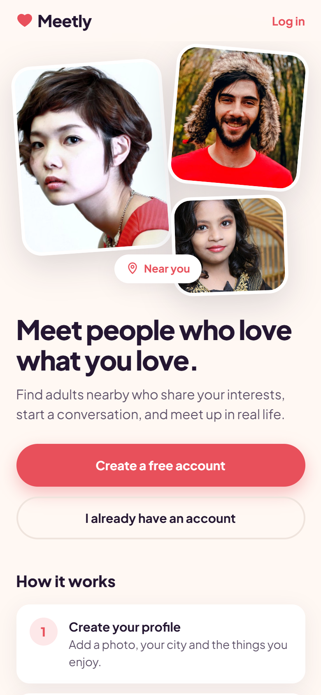 | 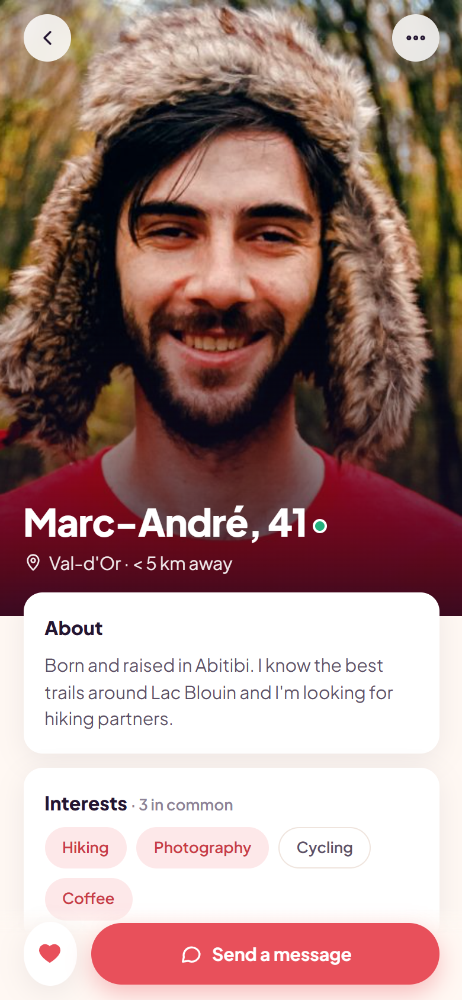 | 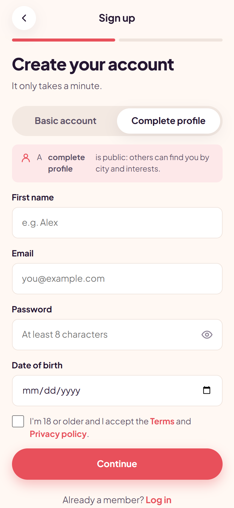 | 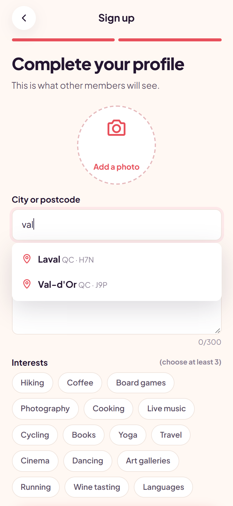 |

| Login | Search & results | City / postcode autocomplete | Another city + interest filter |
|---|---|---|---|
| 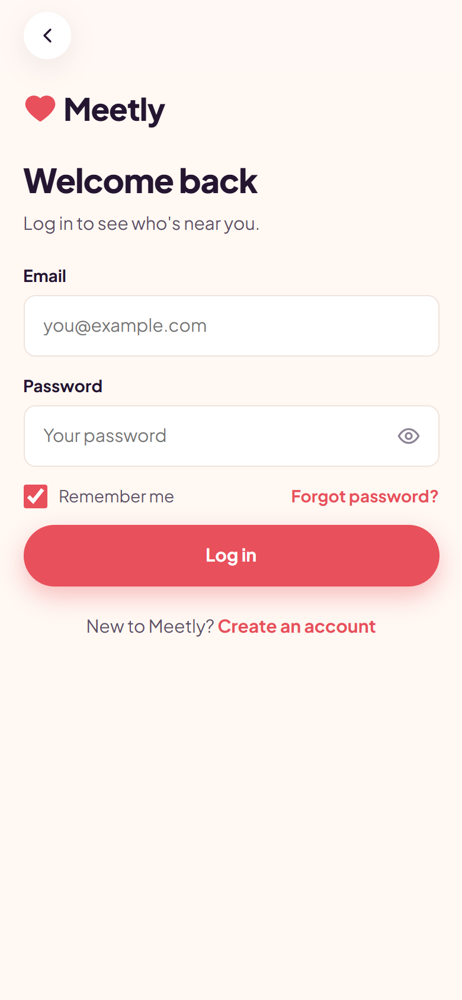 | 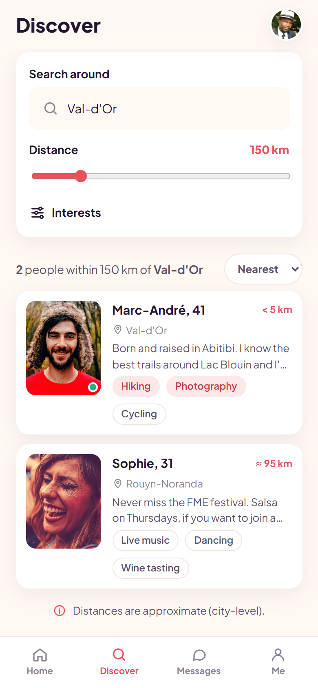 | 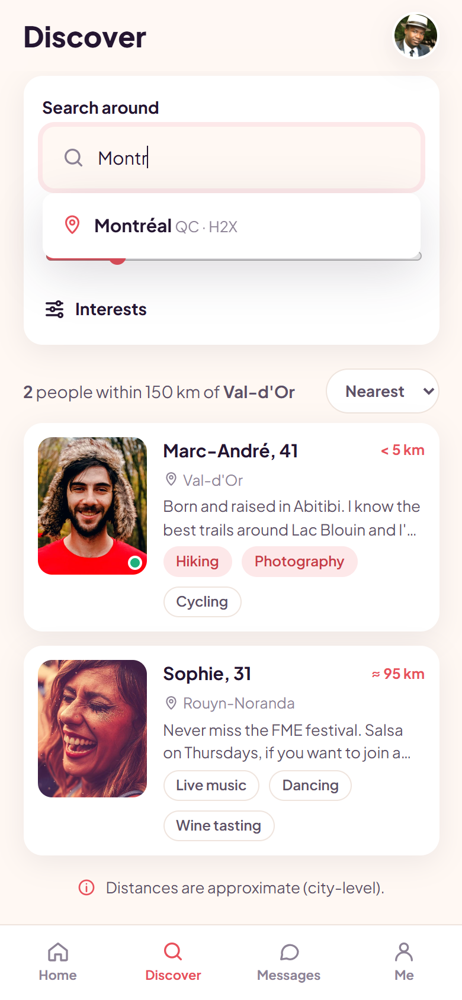 | 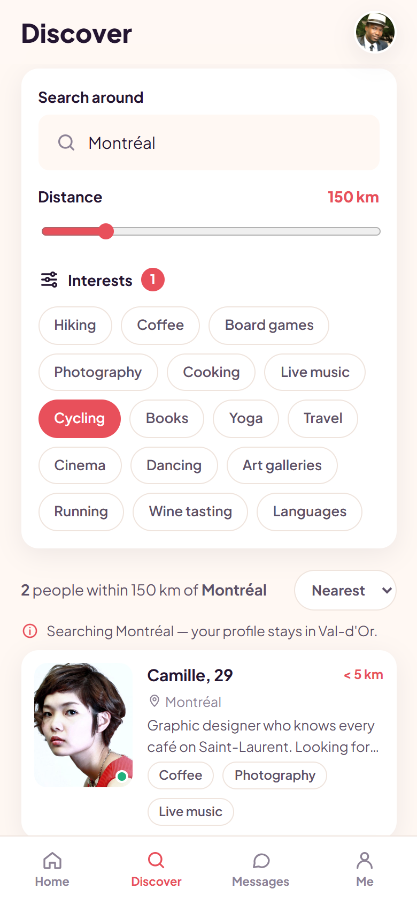 |

| Empty results | Private messaging | Inbox | Block dialog |
|---|---|---|---|
| 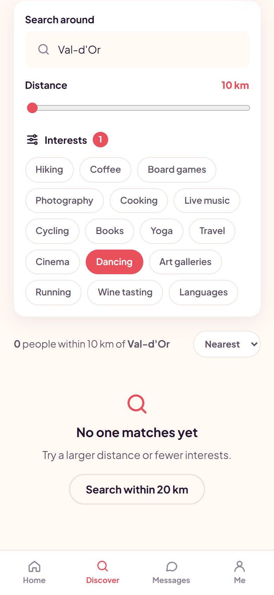 | 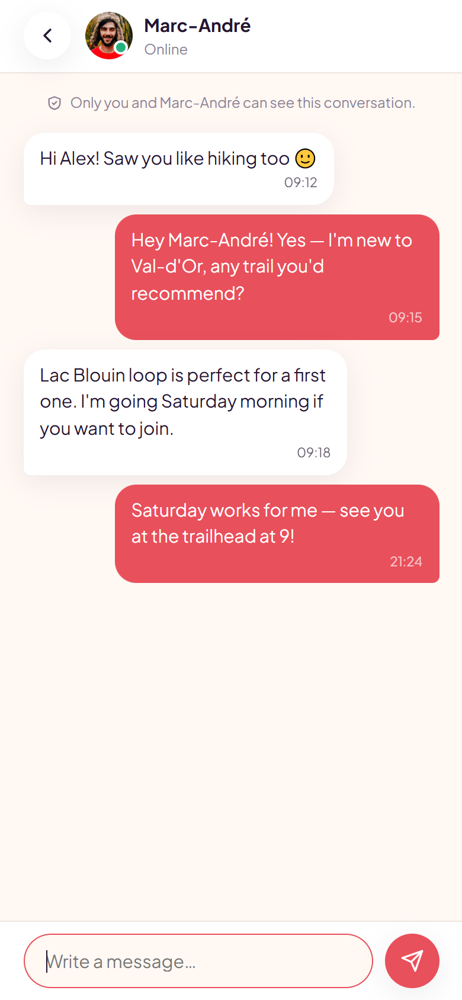 | 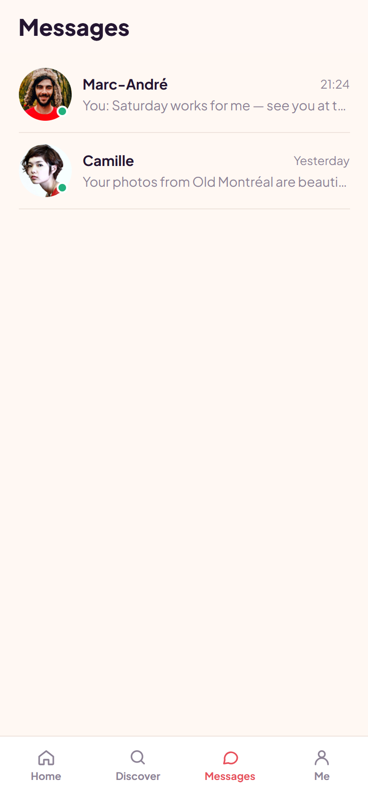 | 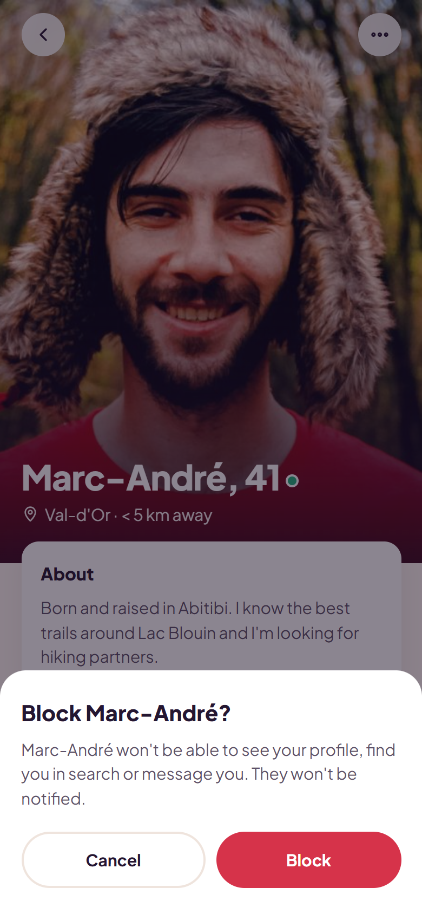 |

| Form validation | Small phone (320 px) | Full homepage |
|---|---|---|
| 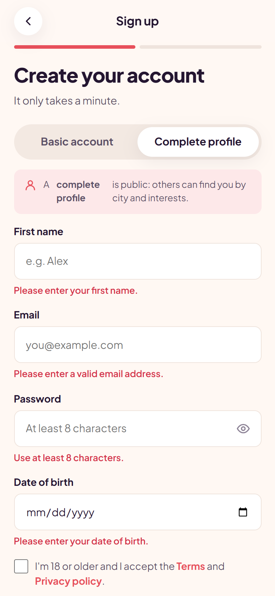 | 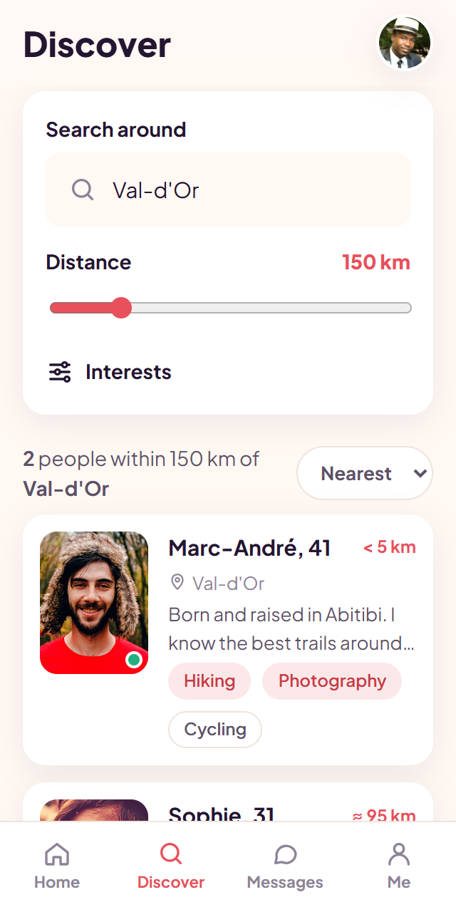 | 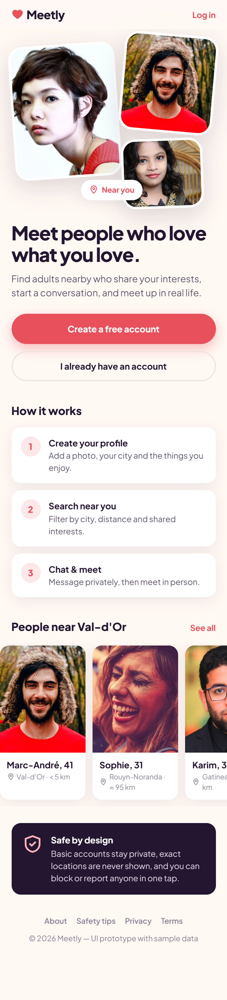 |

---

## Features

### Core screens
- **Homepage**: hero section, sign-up and login buttons, "How it works", a carousel of people nearby, and a safety section.
- **Public profile**: full-bleed photo, approximate distance, introduction, interests (shared ones highlighted), favourite button, block dialog and a sticky "Send a message" button.
- **Sign-up**: choice between a **basic account** (private, not shown in search) and a **complete profile** (public). It's a two-step flow with photo upload preview, city or postcode autocomplete, a 300-character introduction and interest selection. It validates every field and checks the user is 18 or older.
- **Login**: show/hide password, "remember me", a password-recovery dialog and inline errors.
- **Search & results**: city or postcode autocomplete, a distance slider from 10 to 800 km, interest filters, and sorting by nearest or newest. It also handles empty results, errors, and the note *"your profile stays in your city"* when searching elsewhere.

### Location search
- Distances use the **Haversine great-circle formula** between city centres ([`js/geo.js`](js/geo.js)).
- Distances are always shown as **approximate** (`≈ 95 km`, `< 5 km`), so an exact location is never revealed.
- Autocomplete matches accent-insensitive city names (`montreal` → Montréal) and Canadian postcode prefixes (`J9P` → Val-d'Or).
- Results can be filtered by radius and shared interests, then sorted by proximity.

### Messaging (preview)
- Inbox and one-to-one conversation views, with messages saved in `localStorage` for the demo.

### Quality
- **Mobile-only and responsive**: tested from 320 px (iPhone SE) to 480 px wide. It supports safe areas (`env(safe-area-inset-*)`) and `100dvh`, and the page never scrolls sideways.
- **Design tokens**: all colours, radii, shadows and spacing are CSS variables in [`css/styles.css`](css/styles.css), so a supplied design can be matched exactly.
- **Accessibility**: labelled inputs, `aria-invalid` and `aria-pressed` states, dialogs with `role="dialog"`, and support for `prefers-reduced-motion`.
- **Security**: all user text is HTML-escaped before rendering.
- No framework, no build step, no dependencies.

---

## Tech stack

| Layer | Prototype (this repo) | Production (planned for later milestones) |
|---|---|---|
| UI | HTML5, CSS3 (custom properties), vanilla JavaScript | Next.js / React + TypeScript (or keep as-is) |
| Routing | Hash router (`js/app.js`) | Next.js App Router |
| Data | Sample data (`js/data.js`) | PostgreSQL + PostGIS (Supabase) |
| Auth | Client-side validation | Supabase Auth: email verification, password reset |
| Location | Haversine over city centres | Geocoding API (Mapbox / Google Places / Geoapify) + `ST_DWithin` radius queries |
| Messaging | `localStorage` | Realtime channels + row-level security (participants only) |
| Hosting | GitHub Pages | Vercel / Netlify, on the client's accounts |

---

## Project structure

```
meetly-mobile/
├── index.html          # App shell
├── css/
│   └── styles.css      # Design tokens + all component styles
├── js/
│   ├── data.js         # Sample cities, profiles, interests, conversations
│   ├── geo.js          # Autocomplete, Haversine distance, search & sort
│   ├── views.js        # Screens: Home, Profile, Signup, Login, Search, Inbox, Chat
│   └── app.js          # Hash router, state, toasts
└── screenshots/        # Mobile screenshots (390×844 @2x)
```

### Routes

| Route | Screen |
|---|---|
| `#/` | Homepage |
| `#/login` | Login |
| `#/signup` | Sign-up (basic account / complete profile) |
| `#/search` | Search & results |
| `#/profile/:id` | Public profile (`me` = your own) |
| `#/messages` | Inbox |
| `#/messages/:id` | Conversation |

---

## Setup

No installation is needed.

```bash
git clone https://github.com/GITHUB_USER/meetly-mobile.git
cd meetly-mobile

# Option 1 — open directly
start index.html          # Windows   (macOS: open index.html)

# Option 2 — local server (recommended, then open http://localhost:8080)
npx serve -l 8080 .
```

To test on a phone, run the local server and open `http://<your-computer-ip>:8080` on a phone connected to the same Wi-Fi network.

### Deploying the preview (GitHub Pages)
In the repository, go to **Settings → Pages**. Set **Source** to `Deploy from a branch`, choose the `main` branch and the `/ (root)` folder, then save.

---

## Roadmap

| Stage | Scope |
|---|---|
| ✅ **Test** | Five pages and navigation with sample data (this repo) |
| Milestone 1 | Database, sign-up/login/logout, email verification, password recovery, profile creation and editing, settings, account deletion, access controls |
| Milestone 2 | City/postcode autocomplete provider, stored locations, radius and interest search, proximity sorting, empty and error states |
| Milestone 3 | Real-time private messaging (participants only), favourites, notifications, blocking and reporting, admin tools |
| Milestone 4 | Visual polish, info pages and cookie consent, tests on different phone sizes, performance, deployment and handover |

---

Photos are placeholder avatars from [pravatar.cc](https://pravatar.cc). All names, profiles and messages are fictional.
